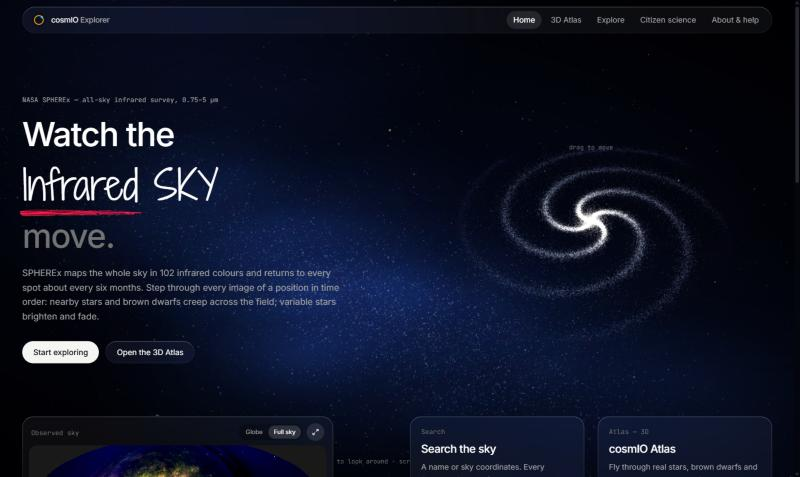
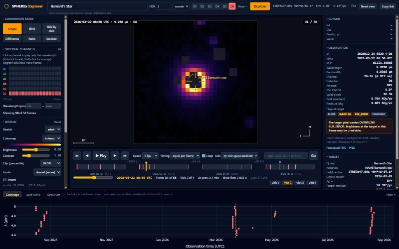
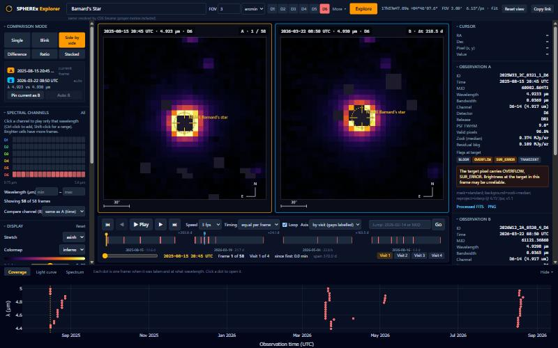
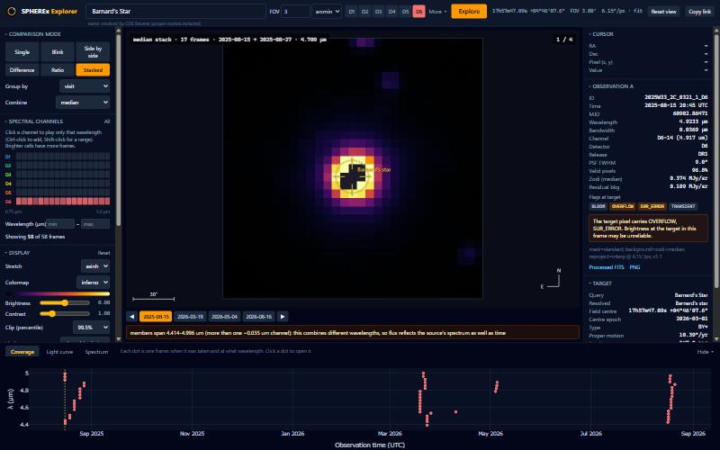
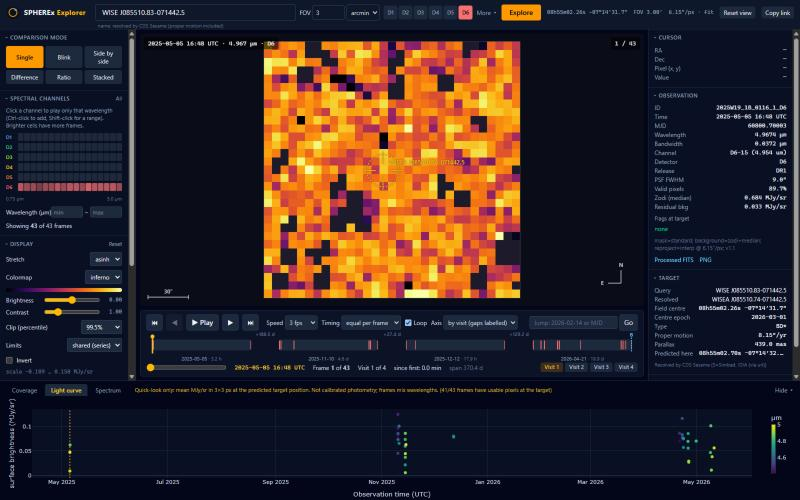

# cosmIO

**Watch the infrared sky move, fly through the real stellar neighbourhood, and help chart what
nobody has classified yet.**

cosmIO is our entry to the NASA Space Apps Challenge 2026, *"Planet X and SPHEREx"*. It is a web
app built on NASA's SPHEREx all-sky infrared survey: a time-lapse image explorer, a 3D atlas of
573,000 real objects, and a citizen-science game played on real SPHEREx data.



> **Our rule:** everything shown comes from real observations or is computed from them. Anything
> that isn't, such as an illustration, a prediction or demo players, carries a visible label.
> Candidates are never presented as discoveries.

---

## Quick start

You need **Python 3.11+** and **Node.js 20.19+** (or 22.12+). No accounts or API keys are needed:
every data service cosmIO uses is public. It works on Windows, macOS and Linux.

```bash
git clone https://github.com/code-il/cosmIO.git
```

```bash
cd cosmIO
```

```bash
python -m venv .venv
```

```bash
.venv\Scripts\python -m pip install -r requirements.txt
```

```bash
.venv\Scripts\python -m scripts.start
```

On macOS/Linux, use `.venv/bin/python` in place of `.venv\Scripts\python`.

The last command builds the viewer the first time it runs, then serves everything at
**http://localhost:8000**:

| Page | Address | What it is |
| --- | --- | --- |
| Home | `/` | Start here: search the sky, preview the Atlas, the observed sky in three wavelengths |
| 3D Atlas | `/map` | Fly through 573k real objects at their measured distances |
| Explorer | `/explore?q=Barnard's Star` | Every SPHEREx image of a spot, as a time-lapse |
| Citizen science | `/science` | The cosmIO game: Daily Survey, investigations, review, leaderboards |
| API docs | `/docs` | Every backend endpoint |

Other ways to run it:

- `python -m scripts.start --dev`: hot reload.
- `python -m scripts.start --check`: checks the installation.
- `docker compose up --build`: runs it in Docker.

---

## The three parts

### 1. Explorer: the infrared sky as a time-lapse

SPHEREx photographs the whole sky in 102 infrared colours (0.75–5 µm) and comes back to each
spot about every six months. The Explorer stacks those visits into a time-lapse, so nearby stars
and brown dwarfs creep across the field and variable stars brighten and fade.



| Side by side: Aug 2025 vs Mar 2026 | Difference image: Barnard's Star moving north |
| --- | --- |
|  |  |
| **Per-visit median stacks** | **WISE 0855 with its light curve** |
|  |  |

*All five use real SPHEREx DR1/QR3 data from NASA/IPAC IRSA: detector D6 (4.4–5.0 µm), 3′ field.*

How it works:

1. **Find.** Your search is resolved to coordinates, and IRSA's image search lists every SPHEREx
   image of that spot.
2. **Prepare.** Each image is cut out, masked and background-subtracted, then reprojected onto
   one sky grid.
3. **Compare.** You can:
   - play the frames in time order;
   - *blink* between two dates, or show them *side by side*;
   - take PSF-matched *difference* and *ratio* images;
   - make median or mean *stacks*.
4. **Analyse.** cosmIO:
   - detects sources and measures their proper motion with errors;
   - builds light curves and spectra;
   - cross-matches against Gaia DR3, CatWISE2020 and known asteroids.

### 2. 3D Atlas: the real neighbourhood in 3D


- **Positions:** every object sits at its measured position. Its direction comes from Gaia DR3
  and its distance from its parallax; the two are converted to Galactic x, y, z in parsecs.
  Flying to a star puts you at its real place.
- **Contents:**
  - every Gaia DR3 star within 100 pc with parallax/error ≥ 10 (329,824 objects);
  - bright stars out to 4 kpc (243,022, a 1-in-3 sample);
  - 4,332 SIMBAD objects that Gaia has no parallax for, such as WISE 0855;
  - 6,470 planets in 4,862 systems, drawn to scale with habitable zones.
- **Classes, each labelled with where it came from:**
  - *measured* from a SPHEREx spectrum;
  - *catalogued* in SIMBAD (77,847);
  - *predicted* by our **k-nearest-neighbour machine-learning model** on Gaia photometry
    (481,372), with **89.7% accuracy** on held-out stars.
- **Orbits:** two-body Kepler orbits at 1 simulated day per second. An optional **N-body engine**
  is checked against JPL Horizons.
- **Frontier mode** ranks regions of space by how much in them is still unclassified.

### 3. cosmIO game: citizen science on real data (`/science`)


- **Daily Survey:** a shared daily puzzle, scored Wordle-style. Everyone classifies the same
  catalogued "anchor" stars. Mixed in, and indistinguishable from them, are real sources that no
  catalogue has classified, so every run surveys new sky.
- **Investigate:** hunt moving objects, classify stars, read spectra and flag image artefacts on
  real SPHEREx observations. Every submission goes through automated quality checks.
- **Review:** independent players check each other's results without seeing who made them.
- **Rewards:** XP, levels, streaks, achievements, weekly challenges and two separate boards. The
  *global contribution* board counts participation; the *scientifically validated* board counts
  only results accepted by an external review.
- **Demo players:** 24 sample players fill the leaderboards and the Daily Survey, so the game
  never looks empty in a demonstration.
  - Every one is marked **demo**.
  - They never count towards community totals, candidates or science results.
  - Turn them off with `SPHEREX_GAME_DEMO=0`, or remove them with `python -m scripts.seed_demo --clear`.

All scoring happens on the server; the game state is a SQLite file created on first use.

---

## Tests

```bash
.venv\Scripts\python -m pytest
```

```bash
cd frontend
```

```bash
npm test
```

There are 215 backend tests and 49 viewer tests. None of them need the network.

## Known limitations

- **The first visit to a field is slow.** It downloads every cutout from IRSA, which takes 1–3
  minutes. If IRSA is down (HTTP 502/503), the Explorer says so instead of guessing.
- **About a year of SPHEREx data so far.** Motions below about 1″/yr cannot be measured yet.
- **Colour is mixed with time.** Each frame is taken at a different wavelength.
- **Positions are a snapshot.** The Atlas shows a 2016 snapshot of positions; stars' motions are
  not animated.
- **Decorative visuals are labelled.** The home page's background star field and draggable spiral
  galaxy are decoration, as is the faint Milky Way disk seen from far out in the Atlas.

## Project layout

```
backend/
  data_acquisition/   SPHEREx archive search (SIA2), FITS cutouts, metadata
  image_processing/   masks, background, reprojection, stacks, difference images
  analysis/           detection, motion, light curves, spectra, classification
  galaxy/             Atlas catalogue, k-NN classifier, SPHEREx spectral classes
  orbits/             N-body engine checked against JPL Horizons
  game/               cosmIO game: daily survey, QA, review, scoring, demo players
  api/                FastAPI app
frontend/             React + TypeScript + Tailwind + three.js
scripts/              start, build_galaxy_map, seed_demo, validation scripts
tests/                offline unit and integration tests
docs/                 sources, API, deployment, demo scenarios, scientific review
```

---

## References

### Data

- [NASA SPHEREx](https://www.jpl.nasa.gov/missions/spherex/): Level 2 spectral images and all-sky
  HiPS (DR1, QR3), via [NASA/IPAC IRSA](https://irsa.ipac.caltech.edu/Missions/spherex.html).
  *"This publication makes use of data from SPHEREx, a NASA mission managed by JPL/Caltech,
  obtained from IRSA."*
- [NASA Exoplanet Archive](https://exoplanetarchive.ipac.caltech.edu/) (pscomppars)
- [JPL Horizons](https://ssd.jpl.nasa.gov/horizons/)
- [ESA Gaia DR3](https://www.cosmos.esa.int/web/gaia/dr3): Gaia Collaboration 2016, 2023 (CC BY-SA 3.0 IGO)
- [SIMBAD](https://simbad.cds.unistra.fr/) (CDS): Wenger et al. 2000
- [CatWISE2020](https://irsa.ipac.caltech.edu/data/WISE/CatWISE/overview.html): Marocco et al. 2021
- [CDS Sesame](https://cds.unistra.fr/cgi-bin/Sesame) name resolver
- [IMCCE SkyBoT](https://ssp.imcce.fr/webservices/skybot/) asteroid service
- [IRAS/IRIS](https://irsa.ipac.caltech.edu/data/IRIS/), [AllWISE](https://wise2.ipac.caltech.edu/docs/release/allwise/), [2MASS](https://irsa.ipac.caltech.edu/Missions/2mass.html), [DSS2](https://archive.stsci.edu/cgi-bin/dss_form): sky surveys shown through Aladin Lite
- [Kopparapu et al. 2014, ApJL 787, L29](https://doi.org/10.1088/2041-8205/787/2/L29): habitable zones

### Software

- **Python:** [Astropy](https://www.astropy.org/), [Astroquery](https://astroquery.readthedocs.io/), [PyVO](https://pyvo.readthedocs.io/), [NumPy](https://numpy.org/), [SciPy](https://scipy.org/), [reproject](https://reproject.readthedocs.io/), [photutils](https://photutils.readthedocs.io/), [Pillow](https://python-pillow.org/), [FastAPI](https://fastapi.tiangolo.com/), [Uvicorn](https://www.uvicorn.org/), [Pydantic](https://docs.pydantic.dev/), [Requests](https://requests.readthedocs.io/), [pytest](https://docs.pytest.org/), [HTTPX](https://www.python-httpx.org/)
- **JavaScript:** [React](https://react.dev/), [React Router](https://reactrouter.com/), [three.js](https://threejs.org/), [Plotly.js](https://plotly.com/javascript/), [Aladin Lite](https://aladin.cds.unistra.fr/AladinLite/), [Tailwind CSS](https://tailwindcss.com/), [Vite](https://vite.dev/), [TypeScript](https://www.typescriptlang.org/), [Vitest](https://vitest.dev/)
- **Fonts:** [Inter](https://fonts.google.com/specimen/Inter), [JetBrains Mono](https://fonts.google.com/specimen/JetBrains+Mono)

The full list with licences is in [docs/SOURCES.md](docs/SOURCES.md).

## Use of AI and branding

- **AI assistance:** code and documentation were written with help from an AI coding assistant
  (Anthropic Claude).
- **No AI images:** no AI-generated images are used anywhere.
- **No AI at runtime:** no AI model runs while the app is used. The only trained model is the k-NN
  classifier described above.
- **Not NASA:** cosmIO is an independent project. It is not produced or endorsed by NASA, JPL,
  Caltech/IPAC or the SPHEREx team, and it uses no NASA logos.
