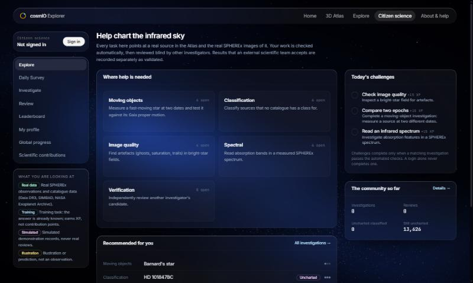
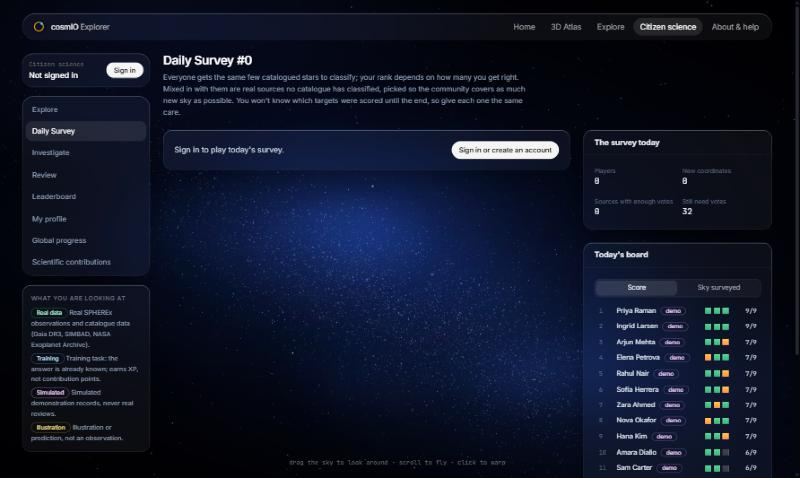
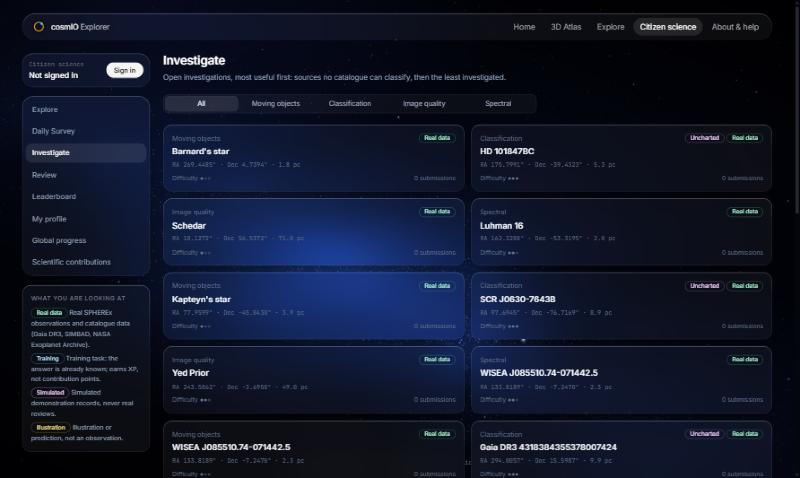
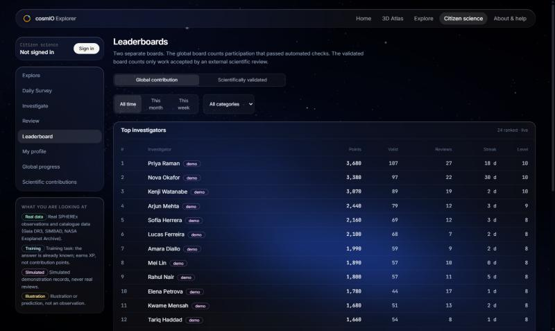
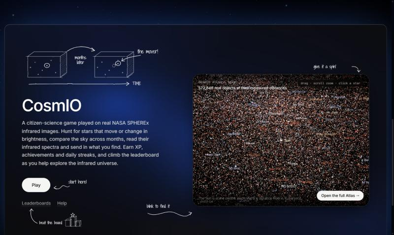
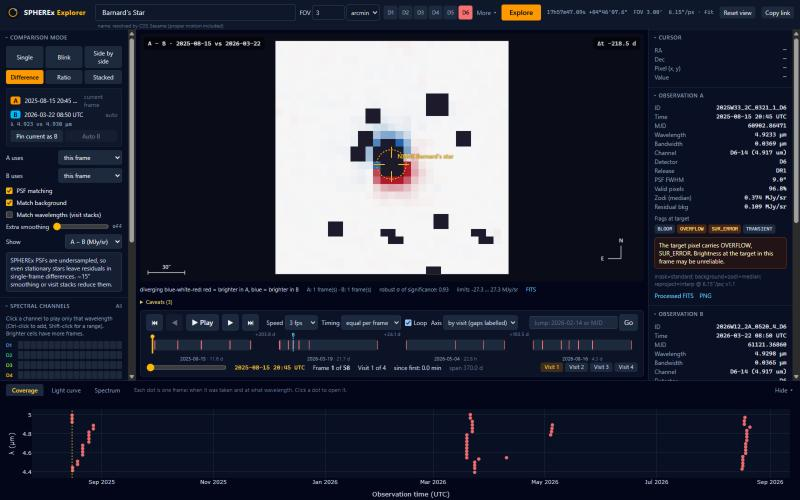

# cosmIO

**Watch the infrared sky move, fly through the real stellar neighbourhood, and help chart what
nobody has classified yet.**

cosmIO is our entry to the NASA Space Apps Challenge 2026, *"Planet X and SPHEREx"*. It is a web
app built on NASA's SPHEREx all-sky infrared survey: a time-lapse image explorer, a 3D atlas of
573,000 real objects, and a citizen-science game played on real SPHEREx data.

> **Presentation for judges:** [**CosmIO.pptx**](CosmIO.pptx), 7 slides: the problem, our
> solution, how science becomes gameplay, why people keep playing, and the team. It's at the top
> level of this repository; on GitHub, open it and press **Download** (or use the
> [direct link](https://github.com/code-il/cosmIO/raw/main/CosmIO.pptx)).


> **Our rule:** everything shown comes from real observations or is computed from them. Anything
> that isn't, such as an illustration, a prediction or demo players, carries a visible label.
> Candidates are never presented as discoveries.

---

## Quick start

You need **Python 3.11+** and **Node.js 20.19+** (or 22.12+). No accounts or API keys are needed:
every data service cosmIO uses is public. It works on Windows, macOS and Linux.

```bash
git clone https://github.com/code-il/cosmIO.git
```

```bash
cd cosmIO
```

```bash
python -m venv .venv
```

```bash
.venv\Scripts\python -m pip install -r requirements.txt
```

```bash
.venv\Scripts\python -m scripts.start
```

On macOS/Linux, use `.venv/bin/python` in place of `.venv\Scripts\python`.

The last command builds the viewer the first time it runs, then serves everything at
**http://localhost:8000**:

| Page | Address | What it is |
| --- | --- | --- |
| Home | `/` | Start here: search the sky, preview the Atlas, the observed sky in three wavelengths |
| 3D Atlas | `/map` | Fly through 573k real objects at their measured distances |
| Explorer | `/explore?q=Barnard's Star` | Every SPHEREx image of a spot, as a time-lapse |
| Citizen science | `/science` | The cosmIO game: Daily Survey, investigations, review, leaderboards |
| API docs | `/docs` | Every backend endpoint |

Other ways to run it:

- `python -m scripts.start --dev`: hot reload.
- `python -m scripts.start --check`: checks the installation.
- `docker compose up --build`: runs it in Docker.

---

## The three parts

### 1. cosmIO game: citizen science on real SPHEREx data (`/science`)

The heart of cosmIO. Players look at real SPHEREx images of real sources, many of which no
catalogue has ever classified, and every answer they give is checked, reviewed and scored.



| Daily Survey: today's shared puzzle and board | Investigate: open tasks on real sources |
| --- | --- |
|  |  |

**How to play**

1. **Daily Survey.** Every player gets the same few catalogued "anchor" stars to classify,
   scored Wordle-style: 🟩 exact, 🟨 a neighbouring class, ⬛ wrong. Mixed in, and indistinguishable
   from the anchors, are real sources that no catalogue has classified, picked so the community
   covers as much new sky as possible. You only learn which targets were scored at the end, so
   every one gets the same care.
2. **Investigate.** Pick a task in one of four kinds:
   - **Moving objects:** measure a fast-moving star at two dates and test it against its Gaia proper motion.
   - **Classification:** classify sources that no catalogue has a class for.
   - **Image quality:** find artefacts (ghosts, saturation, trails) in bright-star fields.
   - **Spectral:** read absorption bands in a measured SPHEREx spectrum.
3. **Automated checks.** Every submission is checked against the real observations: are the
   cited images real, are the dates valid, is the measured motion consistent with Gaia? You get
   the result straight away, with what passed and what didn't.
4. **Blind review.** Other players review each candidate without seeing who submitted it.
   Agreement between independent investigators builds a community consensus.
5. **Rewards.** You earn XP and levels, daily streaks, achievements and daily challenges.

**Two separate leaderboards**

- **Global contribution** counts participation that passed the automated checks.
- **Scientifically validated** counts only results that an external scientific team has accepted.
- Community agreement is never presented as validation.



**Demo players**

24 sample players fill the leaderboards and the Daily Survey board, so the game never looks empty
in a demonstration.

- Each of them is marked **demo**.
- They never count towards community totals, candidates or science results.
- Turn them off with `SPHEREX_GAME_DEMO=0`, or remove them with `python -m scripts.seed_demo --clear`.

**Fair play**

- All scoring happens on the server; the browser never sends points.
- Each reward can be paid only once, even if a request is repeated.
- Training tasks earn XP, not contribution points.
- Rewards shrink for repeated identical work.
- The game state is a SQLite file created on first use.

### 2. 3D Atlas: the real neighbourhood in 3D (`/map`)



- **Positions:** every object sits at its measured position. Its direction comes from Gaia DR3
  and its distance from its parallax; the two are converted to Galactic x, y, z in parsecs.
  Flying to a star puts you at its real place.
- **Contents:**
  - 329,824 Gaia DR3 stars within 100 pc;
  - 243,022 bright stars out to 4 kpc;
  - 4,332 SIMBAD objects that Gaia has no parallax for;
  - 6,470 planets in 4,862 systems, drawn to scale with habitable zones.
- **Classes, each labelled with where it came from:**
  - *measured* from a SPHEREx spectrum;
  - *catalogued* in SIMBAD;
  - *predicted* by our **k-nearest-neighbour machine-learning model** on Gaia photometry, with
    **89.7% accuracy** on held-out stars.
- **Orbits:** Kepler orbits. An optional **N-body engine** is checked against JPL Horizons.
- **Frontier mode** ranks regions of space by how much in them is still unclassified.

### 3. Explorer: the infrared sky as a time-lapse (`/explore`)



SPHEREx photographs the whole sky in 102 infrared colours (0.75–5 µm) and comes back to each
spot about every six months.

1. **Search** a name or coordinates.
2. **Prepare.** cosmIO fetches every SPHEREx image of that spot from IRSA and aligns them on one
   sky grid.
3. **Compare.** Play them as a time-lapse, *blink* between dates, or take PSF-matched
   *difference* images.
4. **Analyse.** It measures motion, light curves and spectra, and cross-matches against Gaia,
   CatWISE and known asteroids.

*Right: a real SPHEREx difference image of Barnard's Star moving north between two visits.*

<br clear="right">

---

## Tests

```bash
.venv\Scripts\python -m pytest
```

```bash
cd frontend
```

```bash
npm test
```

There are 215 backend tests and 49 viewer tests. None of them need the network.

## Known limitations

- **The first visit to a field is slow.** It downloads every cutout from IRSA, which takes 1–3
  minutes. If IRSA is down (HTTP 502/503), the Explorer says so instead of guessing.
- **About a year of SPHEREx data so far.** Motions below about 1″/yr cannot be measured yet.
- **Colour is mixed with time.** Each frame is taken at a different wavelength.
- **Positions are a snapshot.** The Atlas shows a 2016 snapshot of positions; stars' motions are
  not animated.
- **Decorative visuals are labelled.** The home page's background star field and draggable spiral
  galaxy are decoration, as is the faint Milky Way disk seen from far out in the Atlas.

## Project layout

```
backend/
  data_acquisition/   SPHEREx archive search (SIA2), FITS cutouts, metadata
  image_processing/   masks, background, reprojection, stacks, difference images
  analysis/           detection, motion, light curves, spectra, classification
  galaxy/             Atlas catalogue, k-NN classifier, SPHEREx spectral classes
  orbits/             N-body engine checked against JPL Horizons
  game/               cosmIO game: daily survey, QA, review, scoring, demo players
  api/                FastAPI app
frontend/             React + TypeScript + Tailwind + three.js
scripts/              start, build_galaxy_map, seed_demo, validation scripts
tests/                offline unit and integration tests
docs/                 sources, API, deployment, demo scenarios, scientific review
```

---

## References

### Data

- [NASA SPHEREx](https://www.jpl.nasa.gov/missions/spherex/): Level 2 spectral images and all-sky
  HiPS (DR1, QR3), via [NASA/IPAC IRSA](https://irsa.ipac.caltech.edu/Missions/spherex.html).
  *"This publication makes use of data from SPHEREx, a NASA mission managed by JPL/Caltech,
  obtained from IRSA."*
- [NASA Exoplanet Archive](https://exoplanetarchive.ipac.caltech.edu/) (pscomppars)
- [JPL Horizons](https://ssd.jpl.nasa.gov/horizons/)
- [ESA Gaia DR3](https://www.cosmos.esa.int/web/gaia/dr3): Gaia Collaboration 2016, 2023 (CC BY-SA 3.0 IGO)
- [SIMBAD](https://simbad.cds.unistra.fr/) (CDS): Wenger et al. 2000
- [CatWISE2020](https://irsa.ipac.caltech.edu/data/WISE/CatWISE/overview.html): Marocco et al. 2021
- [CDS Sesame](https://cds.unistra.fr/cgi-bin/Sesame) name resolver
- [IMCCE SkyBoT](https://ssp.imcce.fr/webservices/skybot/) asteroid service
- [IRAS/IRIS](https://irsa.ipac.caltech.edu/data/IRIS/), [AllWISE](https://wise2.ipac.caltech.edu/docs/release/allwise/), [2MASS](https://irsa.ipac.caltech.edu/Missions/2mass.html), [DSS2](https://archive.stsci.edu/cgi-bin/dss_form): sky surveys shown through Aladin Lite
- [Kopparapu et al. 2014, ApJL 787, L29](https://doi.org/10.1088/2041-8205/787/2/L29): habitable zones

### Software

- **Python:** [Astropy](https://www.astropy.org/), [Astroquery](https://astroquery.readthedocs.io/), [PyVO](https://pyvo.readthedocs.io/), [NumPy](https://numpy.org/), [SciPy](https://scipy.org/), [reproject](https://reproject.readthedocs.io/), [photutils](https://photutils.readthedocs.io/), [Pillow](https://python-pillow.org/), [FastAPI](https://fastapi.tiangolo.com/), [Uvicorn](https://www.uvicorn.org/), [Pydantic](https://docs.pydantic.dev/), [Requests](https://requests.readthedocs.io/), [pytest](https://docs.pytest.org/), [HTTPX](https://www.python-httpx.org/)
- **JavaScript:** [React](https://react.dev/), [React Router](https://reactrouter.com/), [three.js](https://threejs.org/), [Plotly.js](https://plotly.com/javascript/), [Aladin Lite](https://aladin.cds.unistra.fr/AladinLite/), [Tailwind CSS](https://tailwindcss.com/), [Vite](https://vite.dev/), [TypeScript](https://www.typescriptlang.org/), [Vitest](https://vitest.dev/)
- **Fonts:** [Inter](https://fonts.google.com/specimen/Inter), [JetBrains Mono](https://fonts.google.com/specimen/JetBrains+Mono)

The full list with licences is in [docs/SOURCES.md](docs/SOURCES.md).

## Use of AI and branding

- **AI assistance:** code and documentation were written with help from an AI coding assistant
  (Anthropic Claude).
- **No AI images:** no AI-generated images are used anywhere.
- **No AI at runtime:** no AI model runs while the app is used. The only trained model is the k-NN
  classifier described above.
- **Not NASA:** cosmIO is an independent project. It is not produced or endorsed by NASA, JPL,
  Caltech/IPAC or the SPHEREx team, and it uses no NASA logos.
