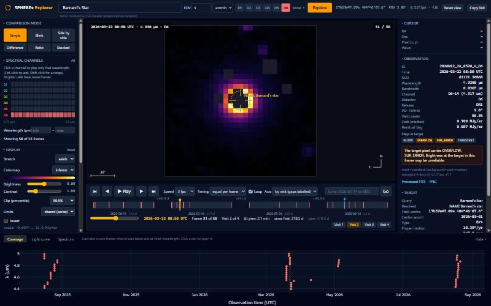
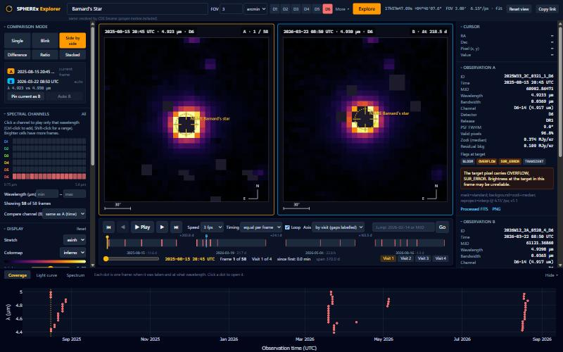
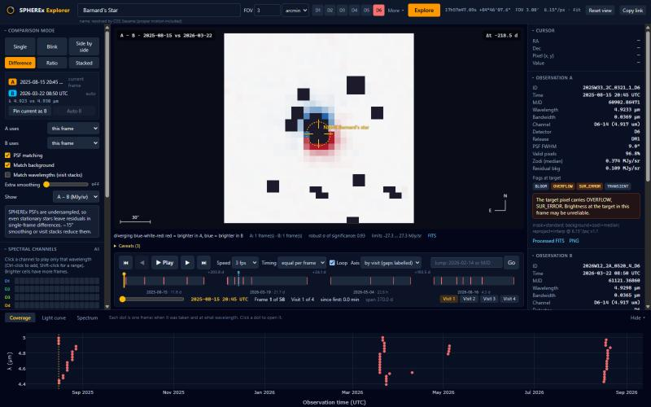
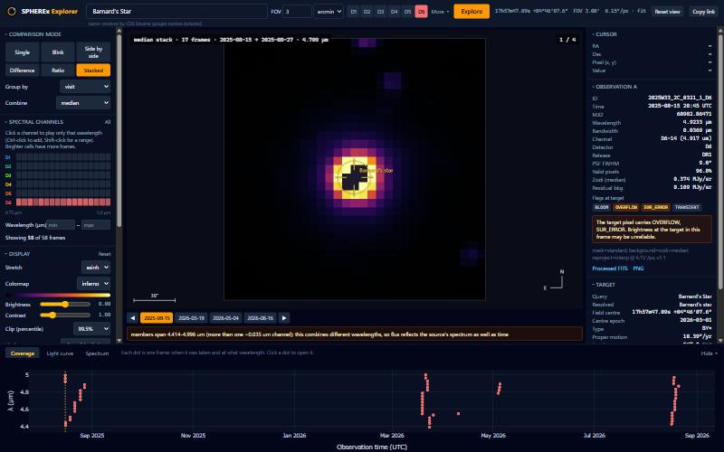
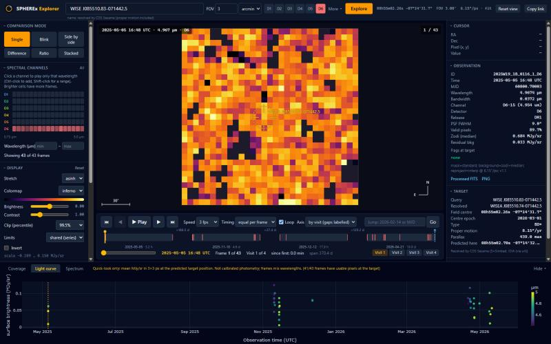

# SPHEREx Explorer: interactive viewer (Workstream 3)

A React + TypeScript + Tailwind web app to explore the NASA SPHEREx images of any
position on the sky **as a time series**. You can play a time-lapse, blink, compare
side by side, difference, ratio and stack frames, pick spectral channels, adjust the
display, and overlay catalogues. All science processing is done by the backend
(Workstreams 1 and 2). The viewer only requests products and draws them.



| Side by side (Aug 2025 vs Mar 2026) | PSF-matched difference: Barnard's Star moving north |
|---|---|
|  |  |
| **Per-visit median stacks** | **WISE 0855 with the quick-look light curve** |
|  |  |

All screenshots use real SPHEREx DR1/QR3 data from IRSA, detector D6 (4.4–5.0 µm), 3′ field.

## Run it

You need Node 20+ and the backend (see the root README).

```bash
.venv\Scripts\python -m uvicorn backend.api.main:app --port 8000
```

```bash
cd frontend
```

```bash
npm install
```

```bash
npm run dev
```

Open http://localhost:5173. The dev server proxies `/api` to `http://localhost:8000`
(override with `SPHEREX_API=http://host:port`).

**No backend or no network?** Run with built-in synthetic data:

```bash
VITE_USE_MOCKS=true npm run dev
```

(PowerShell: `$env:VITE_USE_MOCKS="true"; npm run dev`.) A **MOCK DATA** badge is shown. The
mock sky is fake: a Barnard-like fast mover, static stars, noise, three visits.

Other commands: `npm test` (vitest, 29 tests), `npm run typecheck`, `npm run build` (static
files in `dist/`). For a deployed build that is not behind the dev proxy, set
`VITE_API_BASE=https://your-api.example.org` at build time and add the site's origin to the
backend's `CORS_ORIGINS`.

## Using the viewer

| Area | What it does |
|---|---|
| **Top bar** | Search by name (`Barnard's Star`, `eps Ind B`, `R Dra`) or coordinates: decimal (`269.452 4.693`) or sexagesimal with RA in hours (`17h57m48.5s +04d41m36s`, `17:57:48.5 +04:41:36`, `17 57 48.5 +04 41 36`). Input is checked as you type. Also sets the FOV (deg / arcmin / arcsec; 0.005°–2°), which detectors to load (D1 0.75 µm … D6 5.0 µm), and under **More**: release, date range and the challenge targets. Shows field centre, FOV, pixel scale and zoom, plus **Reset view** and **Copy link**. |
| **Viewer (centre)** | Wheel to zoom about the cursor, drag to pan, double-click or `0` to reset. Pixels stay sharp (no smoothing). Caption: date, wavelength and detector; badge: frame *i / N*. Compass (N/E) and scale bar. A spinner shows while loading; the PNG appears if the FITS cannot be read. |
| **Playback bar** | ⏮ ◀ ▶/❚❚ ▶ ⏭, speed (0.5–12 fps), **Timing**: *equal per frame* or *follows real gaps* (frames before long gaps stay on screen longer), loop, **Axis**: *by visit* (each visit equally wide, true time inside, real gap lengths labelled) or *true time* (linear). The timeline ticks sit at the real observation times and are coloured by detector. Click or drag to scrub. Also shows date/time, frame *i of N*, visit *k of K*, Δt from the previous frame, time since the first frame, total span, jump to a date or MJD, and visit buttons. |
| **Comparison mode** | *Single*, *Blink* (A ↔ B, adjustable interval, coloured border), *Side by side* (zoom/pan locked), *Difference* and *Ratio* (computed by `POST /api/compare`: PSF and background matching, optional smoothing, A/B as a single frame or a whole visit, image or significance σ, caveats and statistics), *Stacked* (`POST /api/process` with `stack_by` visit/day/channel/visit×channel and median/mean/inverse-variance). **A** is the current frame. **B** is automatic (same detector, another visit, closest wavelength) or pinned (**Pin current as B** or key `B`). |
| **Spectral channels** | The 102 nominal channels (6 detectors × 17). Cell brightness = number of frames. Click to play one channel only (a true same-wavelength time-lapse); Ctrl-click to add, Shift-click for a range, or set a µm range. In blink and side-by-side, **Compare channel (B)** shows the frame in another channel closest in time, to compare wavelengths. Kept separate from time playback on purpose. |
| **Display** | Stretch (linear/sqrt/log/asinh), colormap (gray/inferno/magma/viridis), brightness, contrast, clip percentile, limits *shared per detector* (default, so real brightness changes are visible) or *per frame*, invert, reset. **Display only:** the science array and the readouts are never modified. |
| **Overlays** | Target predicted position (proper motion to each frame's date), Gaia DR3 and CatWISE2020 (proper motion applied to each frame's date; magnitude limit), detected sources from the analysis workstream, names, compass. Hover a marker for its details. |
| **Right sidebar** | Cursor readout (RA/Dec, pixel, value in MJy/sr, masked state); metadata for observations A and B (time, MJD, wavelength, bandwidth, channel, detector, release, PSF, valid pixels, zodi, residual background, quality flags at the target with warnings, processing method, FITS/PNG links); target (resolved name, proper motion, parallax, predicted position); series data quality; Aladin Lite sky context (SPHEREx DR1 HiPS, AllWISE, 2MASS, DSS2) with the field footprint. |
| **Bottom panel** | Plotly. *Coverage*: time × wavelength per detector; click a dot to open that frame. *Light curve* and *Spectrum*: photometry from the analysis workstream when available, otherwise a clearly labelled **quick-look** (mean MJy/sr in 3×3 px at the predicted target position; not calibrated). |

Keys: `Space` play/pause · `←`/`→` step · `Home`/`End` · `B` pin B · `+`/`−` zoom · `0`/`R` reset view.

### Shareable URLs

Any view can be opened directly:

```
/explore?ra=269.452&dec=4.693&fov=0.1
/explore?q=Barnard's Star&fov=0.05&mode=difference
/explore?ra=08h55m10.831s&dec=-07d14m42.53s&fov=0.05&det=6&obs=2025W19_1B_0116_1_D6
```

| Parameter | Meaning |
|---|---|
| `q` | Name or coordinate text (resolved by the backend, overrides `ra`/`dec`) |
| `ra`, `dec` | Decimal degrees, or sexagesimal (RA in hours) |
| `fov` | Degrees, 0.005–2 (default 0.05) |
| `det` | Detectors, e.g. `6`, `1,2` or `all` (default `6`) |
| `release` | `DR1`, `QR3`, `all`, … |
| `from`, `to` | Date range (ISO date or MJD) |
| `wmin`, `wmax` | Wavelength range in µm |
| `mode` | `single`, `blink`, `side-by-side`, `difference`, `ratio`, `stacked` |
| `obs` | Observation to open (kept up to date as you step) |
| `stretch`, `cmap` | Display defaults |

Invalid values (e.g. `ra=500`) show an error instead of loading.

## How it fits together

```
SearchBar / URL ──► ExploreParams ──► POST /api/search   (Person 1: observations + predicted target positions)
                                 └─► POST /api/process  (Person 2: aligned frames on one north-up grid)
                                          │ fits_url per frame (SCI, VAR, MASK, FLAGS, RAW, WAVE)
                                          ▼
                     loadPlanes(): background download of every FITS (6 at a time, nearest first)
                                          ▼
              lib/fits.ts (parse) ─► lib/render.ts (stretch/colormap → RGBA) ─► SkyCanvas (zoom/pan/overlays)
Difference/Ratio ─► POST /api/compare ─► DIFF|RATIO / SIG plane      Stacked ─► POST /api/process stack_by
Overlays ─► GET /api/catalog/{gaia|catwise} (backend proxy, cached 7 days) · GET /api/analysis (Person 4)
Analysis panel ─► results_summary · selected source ─► GET /api/light-curve/{id} + /api/spectrum/{id} ─► PlotsPanel
```

Why read FITS in the browser? It lets the viewer re-stretch the real values instantly,
show MJy/sr under the cursor and keep one brightness scale across a whole time-lapse,
without asking the backend for new PNGs. Nothing is processed in the browser: no
alignment, background, masking, differencing or detection. The only exception is the
display mapping and the clearly labelled quick-look box mean.

### Source layout

```
src/
  types.ts                 Data contracts (Person 1, 2, 4 and catalogue JSON) + viewer state types
  lib/api.ts               Backend client, FITS plane cache, mock switch
  lib/fits.ts              Minimal FITS reader (image HDUs, BITPIX 8/16/32/-32/-64)
  lib/wcs.ts               TAN projection pixel <-> sky (checked against astropy in tests)
  lib/render.ts            Stretches, colormaps, percentile limits, RGBA rendering
  lib/time.ts              MJD/date helpers, visit grouping, playback timing
  lib/coords.ts            Coordinate parsing/validation/formatting
  lib/selection.ts         Choosing reference frames (auto B, channel compare, visit sets)
  lib/catalog.ts           Proper-motion propagation for markers
  lib/urlState.ts          Shareable URL <-> state
  lib/glossary.ts          Plain-language explanations for <Term> tooltips and the About page
  state/useSeries.ts       Search + process + background FITS loading
  state/useProducts.ts     Compare, stacks, catalogues, analysis
  components/              SkyCanvas, Timeline, PlaybackBar, ModePanel, ChannelSelector,
                           DisplayControls, OverlayControls, InfoPanels, AladinContext,
                           PlotsPanel, SearchBar, AnalysisPanel (Person 4 results), NavBar, ui (incl. Term)
  pages/                   HomePage, ExplorePage (layout and orchestration), AboutPage (/about: help, glossary, reporting)
  mocks/mockApi.ts         Synthetic backend for VITE_USE_MOCKS=true
  test/                    Real processed FITS fixture + astropy-computed expectations
```

## Integration (for the other workstreams)

The viewer uses the backend JSON unchanged; field names match the Python contracts. See
`src/types.ts` for the TypeScript interfaces.

**Person 1, data acquisition.** The viewer calls `POST /api/search` (body: `q` or `ra`/`dec`,
`fov`, `detectors`, `release`, `date_start`, `date_end`, `wavelength_min`, `wavelength_max`) and
uses only `observation_id`, `target_predicted_ra` and `target_predicted_dec` from it, joined to
processed frames by `observation_id`. If search fails, the viewer still works but draws no
predicted target marker.

**Person 2, image processing.** Needed from the backend:
- `POST /api/process` returning `ProcessResponse` (`grid`, `observations[]` with `fits_url`,
  `image_url`, `wcs`, `mjd`, `wavelength`, `detector`, `channel`, `quality_flags`,
  `display_limits`, …; optional `stacks[]` when `stack_by` is given).
- `POST /api/compare` with `a`/`b` selectors (`observation_ids`) returning `fits_url` with a
  `DIFF` or `RATIO` HDU, and optionally `SIG` and `MASK`.
- FITS products: a `SCI` HDU (float32, TAN WCS) and an optional `MASK` (non-zero = invalid).
  Any image HDU works as a fallback.

**Person 4, analysis.** Optional. Implement `GET /api/analysis?ra=&dec=&fov=` returning:

```json
{
  "sources": [{ "id": "C1", "label": "mover candidate", "ra": 269.45, "dec": 4.77, "mjd": 61100,
                "pm_ra_cosdec_mas_yr": -801, "pm_dec_mas_yr": 10362, "kind": "candidate", "score": 0.97,
                "positions": [{ "observation_id": "2025W33_2C_0321_1_D6", "ra": 269.4463, "dec": 4.7676 }] }],
  "light_curves": [{ "source_id": "C1", "units": "mJy",
                     "points": [{ "mjd": 60902.86, "flux": 1.2, "flux_err": 0.1, "wavelength": 4.92, "observation_id": "..." }] }],
  "spectra": [{ "source_id": "C1", "units": "mJy", "points": [{ "wavelength": 4.92, "flux": 1.2, "flux_err": 0.1 }] }]
}
```

Markers use `positions` for an observation when given, otherwise `ra`/`dec` at `mjd`
propagated with the proper motion. Light curves and spectra replace the quick-look plots,
and clicking a point opens its `observation_id`. Until the endpoint exists, a 404 is
treated as "no analysis".

**Person 5, integration.** The app is a static bundle (`npm run build` → `dist/`). Serve it
with any static host and route `/api` to the FastAPI app (or set `VITE_API_BASE` and CORS).
Client routes are `/` (Atlas), `/targets`, `/about` and `/explore` (redirects into the Atlas), so configure the host's SPA fallback to `index.html`.

## Limitations and notes

- **First visits are slow.** The first `/api/process` for a new field downloads every
  cutout from IRSA (one to a few minutes); later visits are served from the backend cache.
  Loading only one detector (default D6) keeps this manageable.
- **Undersampled PSF.** Single-frame differences leave residuals at stationary stars. Use
  smoothing or visit stacks; caveats from the backend are shown under the difference image.
- **Saturation.** Bright targets (Barnard's Star, RW Aur and R Dra at D6) have masked cores.
  Masked pixels are drawn dark, and the quick-look light curve says when no usable target
  pixels exist.
- **Overlays.** Gaia and CatWISE need the internet (ESA Gaia archive TAP, IRSA cone search;
  typically 3–5 s per field, then cached for 7 days). If unreachable, the overlay shows
  "unavailable" within about a minute instead of blocking the viewer. Positions are linear
  proper motion only (no parallax), which is fine for 6″ pixels. Checked live: CatWISE
  entries for WISE 0855, propagated to a 2025-05-05 frame, land 1.7–3.6″ from the target's
  predicted position, and Gaia DR3 recovers Barnard's Star's motion (−802, +10362 mas/yr).
- **Spurious CatWISE motions.** Around saturated stars CatWISE contains artefacts with large,
  formally significant but fake proper motions (75 within 2.5′ of Barnard's Star). A motion
  above 1″/yr within 150″ of a W2 < 10 source, or with artefact flags, is marked
  `pm_suspect`. Such sources are drawn dashed at their catalogue position and are not
  moved. This flags 74 of those 75 and none of WISE 0855's genuine detections.
- **Mixed wavelengths.** A time-lapse over all channels mixes the source's spectrum into the
  brightness changes; pick one channel for a like-for-like comparison.
- **Aladin Lite** and the HiPS tiles load from CDS/IRSA when the context panel is opened.
- **Bundle size.** Plotly (≈1.4 MB gzip) and Aladin (≈0.85 MB gzip) are separate lazy chunks
  that load only when the plots or the sky context are needed.
